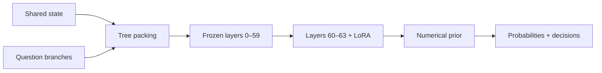

# Canopy-Jev 27B

**Shared context. Parallel decisions. Direct probabilities.**

[English](#english) · [简体中文](#简体中文) · [Weights on Hugging Face](https://huggingface.co/Camellia86/Canopy-Jev-27B) · [MIT](LICENSE)

## English

**Canopy-Jev reaches 87.45% on JevBench, exceeding Open-Jev-27B-v1.1 by 2.16 percentage points.** On the Hard subset it reaches **75.68%, a 3.60-point improvement**. Built on frozen Qwen3.8-27B, it processes a shared application state and multiple isolated question branches, returning probabilities with **zero generated answer tokens**.


### Highlights

- **Higher decision accuracy:** 87.45% on JevBench and 75.68% on Hard; 87.79% family mean.
- **MMLU-Pro 64.50%:** reaching the 60+ target.
- **Compact adaptation:** 6.26M trainable LoRA parameters; adapter and numerical prior total **25.24 MB**.
- **Shared-state inference:** questions reuse the common prefix with isolated attention, convolution and recurrent states.
- **Fast local requests:** default zero-shot API P50 **272–741 ms** on a shared H200 across the nine measured workloads.

### Benchmarks

The figure compares Canopy with Open-Jev's [published JevBench results](https://github.com/Zefan-Cai/Open-Jev/blob/b718c4beaaf13af7d37504a23e99ef599e216e67/docs/jevbench-public.md). The fixed release also reaches **72.00% on JF100**, **64.58% on gated workflow decisions**, and **94.17% on browser proposals**, exceeding the published Open-Jev-27B historical 100-step pilot on these benchmarks. [Complete results](docs/EVALUATION.md) · [Figure data](docs/BENCHMARK_FIGURES.md).

### Install

Linux with NVIDIA CUDA and **at least 64 GiB free GPU memory**. Tested with Python 3.10, PyTorch 2.6.0/CUDA 12.4, Transformers 5.8.0, FLA 0.5.2 and Triton 3.2.0.

```bash
git clone https://github.com/Camellia86/Canopy-Jev.git
cd Canopy-Jev
python3 -m venv .venv
source .venv/bin/activate
python -m pip install -e '.[cuda]'
hf download Camellia86/Canopy-Jev-27B --include 'artifacts/*' --local-dir .
export CUBLAS_WORKSPACE_CONFIG=:4096:8
canopy-jev doctor
canopy-jev inspect --artifacts artifacts
canopy-jev predict --artifacts artifacts \
  --base-model Qwen/Qwen3.8-27B \
  --revision 1d4bf0f2ff6012fd82039f2fa52739d0dd7c60c0 \
  --request examples/request.json --output response.json
```

The base model downloads separately from the pinned official snapshot. An existing compatible local directory can be supplied with `--local-files-only`. The loader verifies configuration, tokenizer, artifacts and tested numerical-library sources. Package validation is recorded in [CPU checks](package_cpu_validation.json), [full-model parity](package_gpu_validation.json) and [clean-install checks](clean_install_validation.json).

### Python API

```python
from canopy_jev import CanopyJev

model = CanopyJev.from_pretrained(
    "artifacts",
    base_model="Qwen/Qwen3.8-27B",
    revision="1d4bf0f2ff6012fd82039f2fa52739d0dd7c60c0",
)
result = model.predict(
    state="The customer received a damaged order and requests a refund.",
    questions=[{
        "id": "route",
        "type": "choice",
        "question": "Which team should receive this request?",
        "criteria": {
            "billing": "Refunds and charges",
            "engineering": "Software defects",
        },
    }],
)
print(result["questions"])
```

| Interface | Output |
|---|---|
| Choice | Distribution and argmax over 1–10 candidates |
| Noul | Boolean choice and probability of `yes`, through a two-candidate adaptation |
| Score | Distribution, selected level and expected level over 1–10 ordered candidates |
| Shared state | Request-local common prefix and isolated question branches, up to 16,384 packed tokens |

The default prompt is the measured `zero_shot_choice` protocol. The historical Pro five-demonstration protocol is available explicitly; its preparation and execution details are in [evaluation protocols](docs/EVALUATION.md).

### Full-request latency

Default zero-shot API on a shared NVIDIA H200. **P50 / P95, milliseconds**:

| State tokens | 1 question | 4 questions | 8 questions |
|---:|---:|---:|---:|
|31|275 / 285|283 / 312|302 / 318|
|511|272 / 282|279 / 296|340 / 348|
|2048|575 / 595|613 / 633|741 / 762|

Timing includes tokenization, the full model, probability decoding and JSON encoding. Model loading measured **37.58 seconds** separately. [Raw aggregate and audit scope](results/latency_zero_shot.json).

### Architecture and training

*Canopy* describes the architecture: one shared trunk supports independent decision branches. Frozen layers 0–59 encode the tree; copies of layers 60–63 carry the LoRA adaptation. Causal tree masks and branch-local positions isolate ordinary attention. Gated DeltaNet prefix convolution and recurrent states are copied into each branch. A numerical prior reads the branch endpoints and returns fixed-policy candidate probabilities.



Training uses sampled Dirichlet policy gradients with CE, Brier and reference KL objectives. [Training details and actual offline W&B curves](docs/TRAINING.md), [input screening](docs/TRAINING_INPUT_SCREEN.md), and [model selection history](MODEL_CARD.md) are available for reproducibility.

### License

Original code and documentation: **MIT**. Base-derived inference artifacts retain **Apache-2.0**. Complete terms and attribution: [LICENSE](LICENSE), [WEIGHTS_LICENSE.md](WEIGHTS_LICENSE.md), [NOTICE](NOTICE), [THIRD_PARTY_NOTICES.md](THIRD_PARTY_NOTICES.md).

## 简体中文

**Canopy-Jev（冠层 Jev）在 JevBench 上达到87.45%，比 Open-Jev-27B-v1.1 高2.16个百分点；Hard子集达到75.68%，高3.60个百分点。** 模型基于冻结Qwen3.8-27B，多个问题共享一份应用状态，通过隔离分支并行计算，直接返回概率，生成答案token数为零。

### 项目亮点

- **决策成绩提升：** JevBench 87.45%，Hard 75.68%，任务族平均87.79%。
- **完整MMLU-Pro 64.50%：** 达到60+目标。
- **轻量适配：** 626万LoRA参数，适配器与概率先验共25.24MB。
- **共享状态、隔离分支：** 同时覆盖注意力、卷积和递归状态。
- **实测响应：** 默认零样本接口在共享H200上的P50为272–741ms。

JF100为72.00%，workflow门控后为64.58%，browser完整方案为94.17%，均超过Open-Jev-27B的**百步历史pilot**。

全部扩展Test/OOD、任务域、游戏及完整比较表保留在 [评测文档](docs/EVALUATION.md)、[绘图数据与对照](docs/BENCHMARK_FIGURES.md) 和 [结果目录](results/)。

### 使用

代码：[GitHub](https://github.com/Camellia86/Canopy-Jev)；权重：[Hugging Face](https://huggingface.co/Camellia86/Canopy-Jev-27B)。安装步骤和Python示例见上方英文部分，另有 [独立中文版说明](README.zh-CN.md)。需要Linux、NVIDIA CUDA及至少64GiB空闲显存；基座使用固定版本的Qwen3.8-27B，单独下载。接口支持Choice 1–10候选、Noul二候选适配和Score有序候选适配；多个问题共享前缀，打包上限16384tokens。

训练采用Dirichlet采样策略梯度，并配合CE、Brier和参考KL。真实离线W&B曲线和方法记录见 [训练证据](docs/TRAINING.md)。原创代码与文档使用完整MIT许可证，基座派生成分保留Apache-2.0。

## Citation / 引用

Author / 作者：**Ruoxi Qiu**。

```bibtex
@software{qiu2026canopyjev,
  author  = {Qiu, Ruoxi},
  title   = {Canopy-Jev: Shared-State Numerical Decision Inference},
  year    = {2026},
  version = {0.1.0},
  url     = {https://github.com/Camellia86/Canopy-Jev}
}
```

Machine-readable citation / 机器可读引用：[CITATION.cff](CITATION.cff)。
