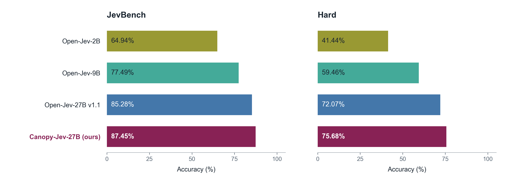
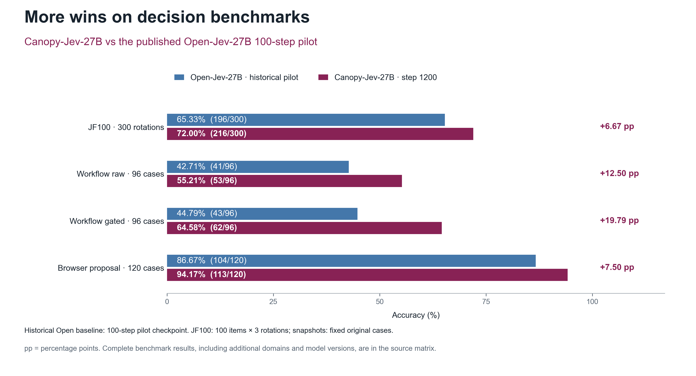

# Benchmark figures / 基准对比图

Canopy-Jev reaches **87.45% on public JevBench** and **75.68% on Hard**: gains of **2.16** and **3.60 percentage points** over Open-Jev-27B-v1.1. The README figure presents the overall and Hard comparison as a compact two-panel chart.

## Main comparison



The four rows compare Open-Jev-2B, Open-Jev-9B, Open-Jev-27B-v1.1 and Canopy-Jev-27B. The chart reports percentages; exact counts and task populations are retained in the aggregate files. Sources: [published Open-Jev data](https://github.com/Zefan-Cai/Open-Jev/blob/b718c4beaaf13af7d37504a23e99ef599e216e67/site/jevbench.json) and [audited Canopy aggregate](../results/jevbench.json).

Download: [PNG](assets/benchmark_comparison.png) · [editable SVG](assets/benchmark_comparison.svg) · [PDF](assets/benchmark_comparison.pdf).

## Additional decision benchmarks



Canopy improves over the published Open-Jev-27B **historical 100-step pilot** by **6.67 points on JF100**, **12.50 points on raw workflow**, **19.79 points on gated workflow**, and **7.50 points on browser proposals**. JF100 comprises 100 items in three option rotations; workflow and browser use 96 and 120 fixed synthetic snapshots. The historical pilot is labeled in the title, legend and caption. The complete protocols and results are in [EVALUATION.md](EVALUATION.md).

Download: [PNG](assets/benchmark_overview.png) · [editable SVG](assets/benchmark_overview.svg) · [PDF](assets/benchmark_overview.pdf).

## Complete public JevBench comparison

The full matrix also retains the other published model streams:

| Model | Overall /231 | Original /72 | Easy /48 | Hard /111 |
|---|---:|---:|---:|---:|
| Open-Jev-2B | 64.94% (150/231) | 77.78% (56/72) | 100.00% (48/48) | 41.44% (46/111) |
| NeoHorse-Jev-4B | 75.32% | NA | NA | NA |
| Open-Jev-9B | 77.49% (179/231) | 90.28% (65/72) | 100.00% (48/48) | 59.46% (66/111) |
| Open-Jev-27B v1.1 | 85.28% (197/231) | 95.83% (69/72) | 100.00% (48/48) | 72.07% (80/111) |
| Jev 1.13.0 | 86.58% (200/231) | 98.61% (71/72) | 100.00% (48/48) | 72.97% (81/111) |
| GPT-5.6 Luna (none) | 89.18% (206/231) | 95.83% (69/72) | 100.00% (48/48) | 80.18% (89/111) |
| GPT-6 Astra (low) | 100.00% (231/231) | 100.00% (72/72) | 100.00% (48/48) | 100.00% (111/111) |
| Canopy-Jev-27B (ours) | 87.45% (202/231) | 97.22% (70/72) | 100.00% (48/48) | 75.68% (84/111) |

NeoHorse's overall score comes from its [pinned model card](https://huggingface.co/TokenRhythm/NeoHorse-Jev-4B/blob/434cb21d3a994a953d3ae5788405fcb2c4970554/README.md); its unpublished tier scores are NA. All other published streams come from the fixed Open-Jev source revision linked above. The README main figure focuses on the three Open-Jev releases and Canopy.

## Data and reproduction

[JSON](../results/benchmark_comparison.json) and [CSV](../results/benchmark_comparison.csv) contain **82 aggregate records**, including JevBench tiers, JF100, snapshots, expanded Test/OOD and local-game metrics. JSON binds each record to one of **17 source entries**, with a URL and SHA-256. Percentages derive from recorded counts where available. Mean game rewards retain their native metric. Detailed evaluation results remain in [the result directory](../results/).

The figures are original vector drawings generated from those aggregates. The rendering source is MIT-licensed. PNGs use 300 dpi for README display; SVG and PDF retain editable text.

```bash
python -m venv .plot-venv
source .plot-venv/bin/activate
python -m pip install matplotlib==3.10.3 numpy==2.2.6
python tools/plot_benchmark_comparison.py --qa-out .plot-qa
```

Run from the repository root. This produces the README PNG/SVG/PDF set from the bundled JSON without loading a model. The source checkpoint is SHA-256 `506410609a6ba6eb422182fddda095b81fa4923011ceaa3717e85a74817237f4`.

## 中文

主图仅呈现JevBench整体与Hard两个面板，去掉题数与外围说明，突出提升：整体 **87.45%（+2.16个百分点）**，Hard **75.68%（+3.60个百分点）**，对照为Open-Jev-27B-v1.1。补充图展示JF100、workflow原始、workflow门控后、browser完整方案的四项提升，对照明确使用历史百步pilot。

完整模型和各域成绩保留在上方表格、82条绘图数据及评测文档中。图表支持PNG、可编辑SVG与PDF，仓库内脚本可直接重绘。
